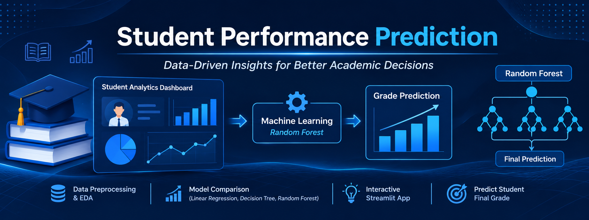
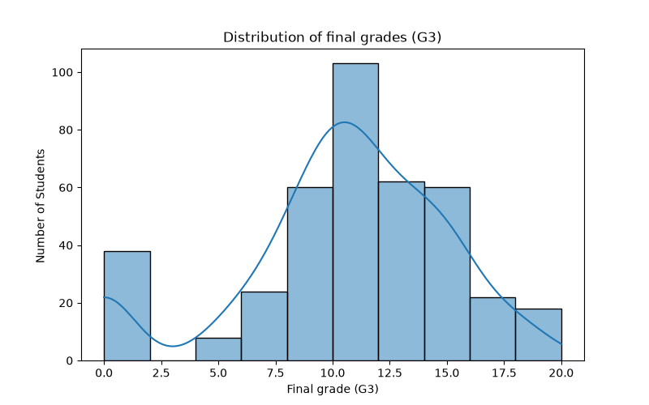
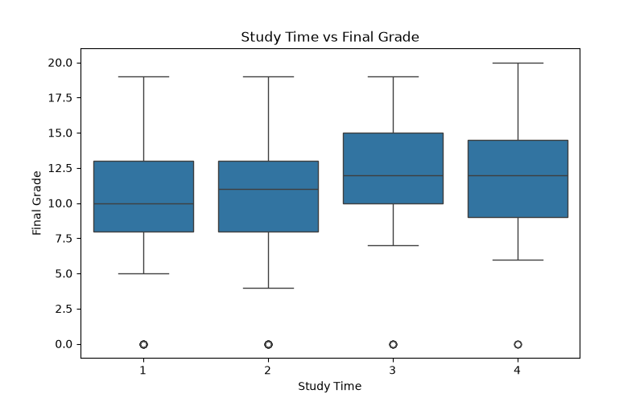
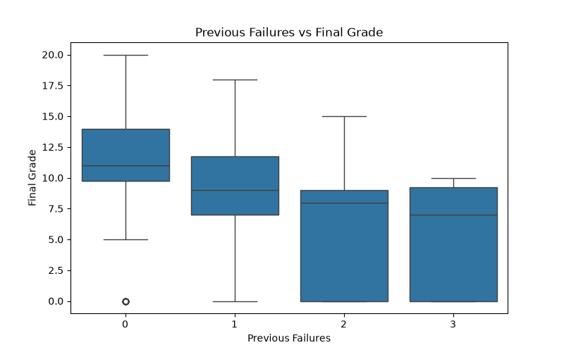
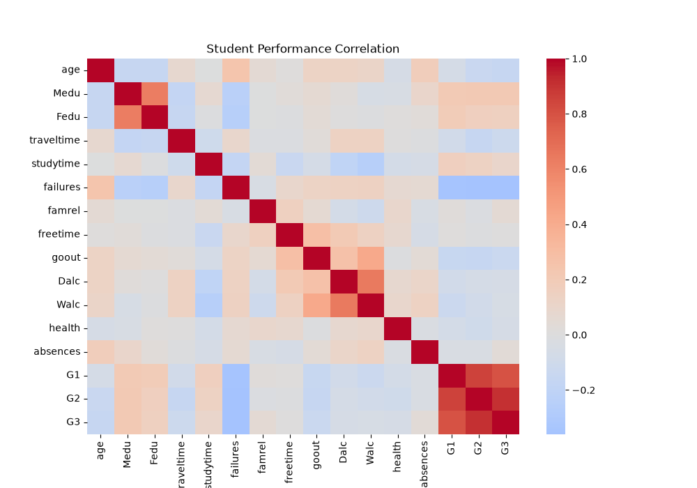

# Student Performance Prediction & Analytics System

<p align="center">
  
</p>

<p align="center">
  <a href="https://student-performance-prediction-samarth-0909.streamlit.app/">
    <strong>🚀 Launch Live Application</strong>
  </a>
</p>

A Python and Machine Learning project that analyses student academic performance and predicts final mathematics grades using multiple regression models.

## About the Project

The Student Performance Prediction & Analytics System explores student demographic, social, and academic information to identify patterns associated with academic performance.

It uses data preprocessing, exploratory data analysis, machine learning model comparison, and an interactive Streamlit application.

## Features

- Student dataset exploration and analysis
- Data preprocessing and categorical encoding
- Feature scaling and train-test splitting
- Exploratory data visualisations
- Linear Regression, Decision Tree and Random Forest comparison
- Final grade prediction for individual students
- Interactive Streamlit dashboard
- Prediction results and CSV downloads

## Technologies Used

- Python
- Pandas and NumPy
- Scikit-learn
- Matplotlib and Seaborn
- Streamlit
- Joblib
- Git and GitHub

## Dataset

**Source:** [UCI Student Performance Dataset](https://archive.ics.uci.edu/dataset/320/student+performance)

This project uses the mathematics dataset (`student-mat.csv`), containing 395 student records and 33 original columns, including the final grade (`G3`).

## Machine Learning Results

The models were evaluated on a held-out test set.

| Model | MAE | R² Score |
|---|---:|---:|
| Linear Regression | 1.647 | 0.724 |
| Decision Tree | 1.278 | 0.733 |
| Random Forest | 1.209 | 0.803 |

**Best-performing model: Random Forest**

- MAE: 1.209
- R² Score: 0.803

These results describe this particular train-test evaluation and are not a guarantee of future prediction accuracy.

## Project Visualisations

### Grade Distribution


### Study Time vs Final Grade


### Previous Failures vs Final Grade


### Correlation Heatmap


## Project Structure

```text
Student-Performance-Prediction/
│
├── data/
│   └── student-mat.csv
│
├── models/
│   └── student_performance_model.pkl
│
├── reports/
│   ├── correlation_heatmap.png
│   ├── failures_vs_grade.png
│   ├── grade_distribution.png
│   ├── studytime_vs_grade.png
│   └── prediction_results.csv
│
├── src/
│   ├── app.py
│   ├── compare_models.py
│   ├── eda.py
│   ├── load_data.py
│   ├── predict.py
│   ├── preprocess.py
│   └── train_model.py
│
├── .gitignore
├── README.md
└── requirements.txt
```

## Run Locally

### 1. Clone the repository

```bash
git clone https://github.com/samarth-0909/Student-Performance-Prediction.git
cd Student-Performance-Prediction
```

### 2. Create a virtual environment

```bash
python -m venv .venv
```

### 3. Activate it on Windows PowerShell

```powershell
.\.venv\Scripts\Activate.ps1
```

### 4. Install dependencies

```bash
pip install -r requirements.txt
```

### 5. Launch the Streamlit application

```bash
python -m streamlit run src/app.py
```

## Live Demo

[Open Student Performance Prediction](https://student-performance-prediction-samarth-0909.streamlit.app/)

## Author

**Samarth Bhat**

Third Year (TY) Data Science Portfolio Project.

[GitHub Profile](https://github.com/samarth-0909)